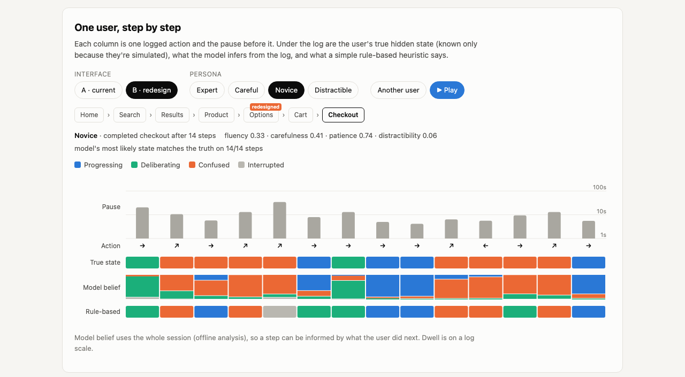

# Reading the Trace: inferring user states from interaction behaviour

*Julia Donovan · Python (NumPy) · [**▶ Interactive results and trace explorer**](https://jul-de.github.io/user-state-inference/)*

Analytics logs what people *do*: clicks, pauses, going back. Product teams want to know what people *are*: confused, deliberating, engaged, gone. This project builds a synthetic population of users moving through a checkout flow, with known hidden states, and tests how much of those states can be recovered from the interaction trace alone. Above all, it looks at **where behaviour stops being informative**.



## Why simulate first

With real clickstreams you never see the hidden state, so you can't tell whether an inference method works or only looks plausible. Simulation flips that: every user's state is known, so recovery can be measured exactly. But simulation has its own trap. If the inference model is the generator, recovery is guaranteed by construction. So here the two are deliberately different:

- **The generator** is rich. Each user has traits (tech fluency, carefulness, patience, distractibility) drawn around one of four personas (expert, careful, novice, distractible). Their state at each step depends on their previous state, how clear the current page is *to someone with their fluency*, and their traits. Dwell times scale with page complexity and reading speed, and confused users abandon, sooner if impatient.
- **The inference model** is a plain four-state hidden Markov model (HMM), written from scratch in NumPy. Each step emits an action (forward, back, repeated click, off-path link) and a page-normalised log dwell time. It knows nothing about pages, traits or personas, so it's tested while misspecified, as it would be on real users.

## Findings

All numbers are on 1,000 held-out users (9,389 steps) and come from `python scripts/run_all.py` (fixed seeds).

**1. Without labels, the model finds user types, not states.** Fitted to unlabelled traffic alone (balanced accuracy 0.55; chance is 0.25), the HMM spends its states on the biggest source of variation in dwell time: *who the user is*. 77% of experts' truly-progressing steps land in its fastest state, while 73% of novices' land in a slower state whose profile looks like "deliberating". A novice doing fine looks like an expert thinking hard. Different random starts also disagree (0.52–0.80), and without ground truth there's no way to tell which is right.

**2. A handful of labelled sessions fixes most of this, and more labels don't raise the ceiling.** Anchoring the HMM on a small study where states have been coded (think-aloud or experience sampling), then refining it by EM on unlabelled traffic, gives 0.79 with 25 labelled users and 0.80 with only 10. With 200 it's 0.80. The limit isn't data, it's states that produce overlapping behaviour: 11% of deliberating steps are read as confused and 15% of confused steps as deliberating. Going further needs a new signal, not more of the same one.

| Model | Balanced accuracy | Confused: recall | Confused: precision | Calibration error, P(confused) |
|---|---|---|---|---|
| Rule-based heuristic | 0.77 | 78% | 53% | 0.127 |
| HMM, no labels | 0.55 | 80% | 61% | 0.061 |
| HMM, anchored on 25 labelled users | 0.79 | 72% | 76% | 0.007 |
| ... dwell time only | 0.69 | 64% | 48% | 0.068 |
| ... actions only | 0.42 | 65% | 66% | 0.007 |
| ... no sequence context | 0.76 | 74% | 67% | 0.020 |

**3. Probabilities beat flags.** A typical rule-based heuristic (long pause → interrupted, repeated click or off-path → confused, and so on) catches 78% of confused steps, but only 53% of its flags are right, and its 0/1 output can't express uncertainty. Its overall balanced accuracy (0.77) is close to the model's, and it's an optimistic baseline: its thresholds were set with knowledge of how the generator works, which a real analyst wouldn't have. Its weakness is precision and calibration, not coverage. The anchored model's probabilities are calibrated (expected calibration error 0.007): when it says 70% confused, the user is confused about 70% of the time. Removing either signal hurts a lot (dwell only 0.69; actions only 0.42). Sequence context helps a little (0.76 without it), because confusion tends to persist.

**4. Same behaviour, different cause.** 199 held-out steps show identical behaviour: going back after an 8–14 second pause. When the user was truly confused, the model calls it correctly 91% of the time, because the surrounding steps give it away. When the same behaviour came from deliberation, it's close to a coin flip (average P(confused) 0.48), which is the honest answer. A dashboard metric that counts "back after a long pause" as confusion would overcount it, and might push a redesign to remove careful comparison.

**5. Testing a redesign on a synthetic population.** Design B hides "Add to cart" on the Options page inside a dropdown (2,000 simulated users per design). The model, trained only on the old design's traffic, finds the problem page: inferred confusion there rises 19 points (95% CI 16–21, resampling users), with knock-on rises on the neighbouring pages. But the true rise is 28 points. Of the truly confused steps on the redesigned page, the model reads 17% as deliberating. A model of behaviour inherits the interface it was trained on, so a redesign can bias the measurement of the redesign itself. The cost also falls unevenly: novices' abandonment goes from 10% to 25%.

**6. It's weakest for the users whose confusion is rarest.** Confused-step recall is 61% for distractible users and 65% for experts, against 76% for novices. Experts' confusion is brief and fast, and distractible users' confusion is mixed in with long absences. A single accuracy figure would hide this.

## What this can't show

- **That real users behave like this.** The generator is a set of assumptions about how states produce behaviour. The results show what is recoverable *if* behaviour works this way. They're a method check and a design tool, not evidence about people.
- **Real labels.** Anchoring assumes states can be coded in a small study. Real coding (think-aloud, in-the-moment probes) is noisy and changes behaviour, and that isn't modelled.
- **Live inference.** Beliefs use the whole session (forward-backward smoothing). Real-time detection would only have the past, and would be less accurate.

The natural next step is to run the same pipeline on real sessions with sparse in-the-moment probes ("Are you finding what you need?") and compare the model's posterior with the answers. That would turn the recovery numbers here into a measure of fidelity to real users.

## Repository

```
usersim/simulate.py    synthetic users: personas, traits, hidden states, logged behaviour
usersim/hmm.py         HMM (batched forward-backward, Baum-Welch EM, ablation variants, labelled anchoring)
usersim/evaluate.py    features, label-free state naming, rule baseline, recovery and calibration metrics
scripts/run_all.py     every analysis; writes docs/data/results.json and bank.json
tests/                 includes a brute-force check of the forward pass over every hidden path
docs/                  the interactive page (GitHub Pages)
```

```bash
pip install -r requirements.txt
python -m pytest            # 9 tests
python scripts/run_all.py   # about a minute; prints a report and rewrites docs/data/
python -m http.server -d docs   # then open http://localhost:8000
```

## A note on AI assistance

This project was built with AI assistance. The project idea came from a conversation with ChatGPT. Claude (Anthropic) wrote the simulator, the model, the analyses, the tests and the interactive page, working from my direction on scope and framing. I reviewed the results and the claims made about them.
